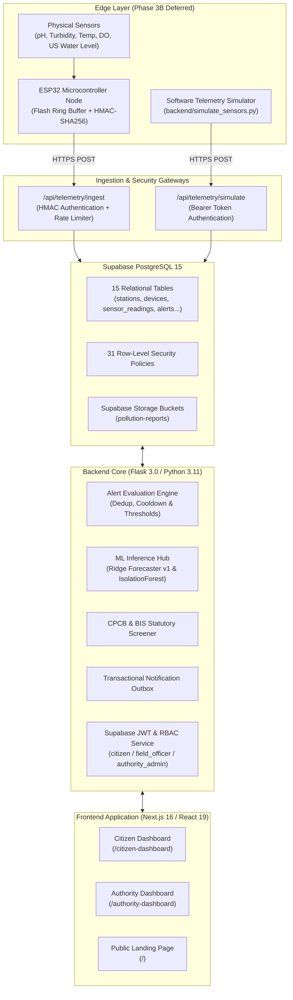

# River Sentinel 2.0 🌊
### Geospatially-Intelligent Urban River Protection and Early Warning Platform
**Target Geography: Ganga River, Varanasi, Uttar Pradesh, India**

[](https://github.com/cmbarath/RiverSentinel/actions/workflows/ci.yml)
[](LICENSE)
[](https://nextjs.org/)
[](https://flask.palletsprojects.com/)
[](https://supabase.com/)

River Sentinel 2.0 is an enterprise-grade environmental intelligence and disaster management platform engineered to safeguard the sacred urban stretch of the Ganga River in Varanasi. It unites high-precision IoT telemetry ingestion, statutory environmental screening, machine learning hydrological forecasting, role-based authority command operations, and citizen engagement into a single, unified operational system.

---

## 📋 Table of Contents
1. [Problem Statement](#-problem-statement)
2. [Project Objectives](#-project-objectives)
3. [Key Platform Capabilities](#-key-platform-capabilities)
4. [System Architecture](#-system-architecture)
5. [Technology Stack](#-technology-stack)
6. [Database Architecture & Schema](#-database-architecture--schema)
7. [Machine Learning & Model Governance](#-machine-learning--model-governance)
8. [Statutory Environmental Standards](#-statutory-environmental-standards)
9. [Hardware & IoT Ingestion Framework](#-hardware--iot-ingestion-framework)
10. [Local Development Setup](#-local-development-setup)
11. [Environment Configuration](#-environment-configuration)
12. [API Reference & Route Contracts](#-api-reference--route-contracts)
13. [Verification & Test Suites](#-verification--test-suites)
14. [Current Implementation Status](#-current-implementation-status)
15. [Disaster Recovery & Operational Resilience](#-disaster-recovery--operational-resilience)
16. [Known Platform Limitations](#-known-platform-limitations)
17. [Roadmap & Deferred Hardware Integration](#-roadmap--deferred-hardware-integration)
18. [License & Attribution](#-license--attribution)

---

## 🌍 Problem Statement
The Ganga River at Varanasi serves millions of resident citizens, pilgrims, and tourists daily across its 84 historic ghats. However, the urban river corridor faces chronic and acute environmental risks:
- **Severe Inundation:** Monsoon flooding regularly crosses the Central Water Commission (CWC) Warning Stage (70.26 m) and Danger Stage (71.26 m), threatening lives, temple complexes, and riparian infrastructure.
- **Micro-Scale Pollution:** Untreated domestic sewage from historic drains (nalas) like Assi and Varuna creates acute bacteriological and organic contamination.
- **Information Fragmentation:** Citizens lack real-time scientific guidance regarding bathing water safety, and authorities lack centralized, tamper-resistant operational situational awareness.

---

## 🎯 Project Objectives
- **Standardized Environmental Screening:** Automatically evaluate multi-station water telemetry against statutory **Central Pollution Control Board (CPCB) Designated Best Use Class B** and **Bureau of Indian Standards (BIS IS 10500:2012)** criteria.
- **Hydrological Forecasting:** Predict water surface elevation at Varanasi based on upstream CWC gauge telemetry (Prayagraj, Mirzapur) and local rainfall using governed statistical machine learning models.
- **Incident Lifecycle Management:** Provide a database-backed, audit-logged alert engine with automated deduplication, rate-limiting, and role-based incident resolution.
- **Operational Resiliency:** Maintain independent PostgreSQL disaster recovery procedures, structured JSON observability, and robust fallback baselines.

---

## 🌟 Key Platform Capabilities

### 🛡️ Citizen Portal
- **Statutory Bathing Safety Checker:** Transparent screening of river conditions at major ghats against CPCB Class B requirements (pH, Dissolved Oxygen, BOD, and Total Coliform).
- **Interactive Geospatial Visualization:** Leaflet-powered GIS map rendering monitoring nodes, CWC reference gauges, and flood susceptibility zones.
- **Citizen Incident Reporting:** File geolocated pollution incidents with image attachments, stored securely in Supabase Storage with dedicated citizen isolation.
- **AI Assistant:** Multilingual query assistant powered by Groq AI supporting English, Hindi, and regional dialects with automatic fallback.
- **Notification Preferences:** Self-service configuration of alert severities and communication channels (in-app, email, and cellular SMS opt-in).

### 🏢 Authority Command Operations
- **Real-Time Command Center:** Unified tactical overview aggregating active stations, device runtime health, alert volumes, and CWC water surface elevation.
- **Alert Triage & Resolution:** Full lifecycle tracking for water quality and flood events (`ACTIVE` -> `ACKNOWLEDGED` -> `RESOLVED`), capturing timestamps, responding officer IDs, and mandatory resolution reasons.
- **Statutory Legal Notice Generator:** Rapid dispatch engine generating formal environmental violation notices with unique tracking hashes.
- **Telemetry Export Engine:** Export filtered, canonical CSV datasets with explicit physical measurement units (`°C`, `NTU`, `mg/L`, `m`).
- **Transactional Telephony Gateway:** Safe cellular broadcast system operating with deduplication, rate limits, and fallback mock dispatch.

---

## 🏗️ System Architecture



---

## 💻 Technology Stack

| Layer | Component | Version / Specification | Role |
|---|---|---|---|
| **Frontend** | Next.js | 16.1.6 (Turbopack) | Server-side rendered and static application shell |
| | React | 19.0.0 | Component rendering engine |
| | TypeScript | 5.0+ | Strict type safety across client interfaces |
| | Tailwind CSS | 3.4.1 | Utility-first styling with responsive glassmorphism |
| | Lucide React | Latest | Accessible iconographic system |
| **Backend** | Flask | 3.0.0 | RESTful API microframework |
| | Python | 3.11 | Application runtime environment |
| | scikit-learn | 1.3+ | Machine learning training and inference |
| | pandas / NumPy | Latest | Hydrological data processing and transformation |
| | psycopg2-binary | Latest | Low-level PostgreSQL driver for disaster recovery |
| **Database** | PostgreSQL | 15.8 (Supabase) | Relational operational datastore |
| | Supabase Auth | GoTrue | JWT session authentication and user management |
| | Row Level Security | PostgreSQL RLS | Table-level authorization and tenant isolation |
| | Supabase Storage | S3-Compatible | Encrypted storage for citizen report imagery |
| **External AI** | Groq Cloud | `llama-3.3-70b` | Natural language conversational assistance |
| **Telephony** | Twilio / Mock | REST API | Transactional SMS dispatch engine |

---

## 🗄️ Database Architecture & Schema

The operational datastore consists of 15 fully-indexed PostgreSQL relational tables secured by 31 Row-Level Security (RLS) policies and comprehensive foreign key integrity constraints:

```
public
├── profiles                    # User metadata, assigned role, and contact numbers
├── stations                    # Physical and planned monitoring stations along Ganga
├── devices                     # IoT hardware registries, firmware versions, heartbeat status
├── station_assignments         # Junction mapping field officers to monitoring stations
├── sensor_readings             # Immutable, time-series telemetry records
├── cwc_reference_gauges        # Upstream CWC hydrological stations (Prayagraj, Mirzapur, etc.)
├── alerts                      # Operational incident records with state machine tracking
├── alert_rules                 # Dynamic, database-driven threshold and condition rules
├── notifications               # Historical user notifications across in-app/email/sms
├── notification_preferences    # Granular user channel and severity subscription settings
├── notification_outbox         # Transactional dispatch queue with exponential backoff
├── citizen_reports             # Citizen pollution reports with geolocation and status
├── audit_logs                  # Tamper-evident system actions and administrative logs
├── offline_sync_log            # ESP32 ring buffer upload synchronization batches
└── recovery_verification_table # Automated canary table for disaster recovery validation
```

---

## 🧠 Machine Learning & Model Governance

River Sentinel 2.0 enforces strict scientific validation and governance across all statistical models.

### 1. Flood Stage Forecaster v1 (`backend/ml/models/flood_stage_forecaster_v1.pkl`)
- **Algorithm:** Ridge Regressor with L2 Regularization (`alpha=10.0`).
- **Objective:** 24-hour advance forecasting of Ganga water surface elevation at Varanasi (metres above MSL).
- **Benchmark Performance (Held-out 2020 Test Year):**
  - Mean Absolute Error (MAE): **0.7882 metres** (outperforming persistence and non-linear models).
  - Root Mean Squared Error (RMSE): **0.9719 metres**.
  - Out-of-sample $R^2$: -0.0399 (reflecting lower dry-season variance relative to training years).
  - Features: 17 inputs including upstream CWC water levels, regional precipitation, antecedent moisture, and seasonality sine/cosine transforms.
- **Operational Classification:** `research_only`. Prompts warning banners in dashboards and does not trigger automatic emergency broadcasts without human authority approval.

### 2. Water Quality Anomaly Detector v1 (`backend/ml/models/wq_anomaly_detector_v1.pkl`)
- **Algorithm:** Isolation Forest (`contamination=0.03`).
- **Objective:** Unsupervised detection of anomalous industrial discharges, sensor calibration drift, and severe pollution spikes.
- **Operational Classification:** `experimental`.

### 3. Retired Legacy Baselines
- Legacy models (`backend/flood_model.pkl` and `backend/water_quality_model.pkl`) exhibiting artificial 99.5%+ accuracy due to synthetic random splits have been retired from production inference paths and preserved exclusively as historical comparison baselines.

---

## 🌿 Statutory Environmental Standards

### CPCB Designated Best Use — Class B (Outdoor Bathing)
Screening against statutory primary water quality criteria established by the Central Pollution Control Board (CPCB):

| Parameter | Statutory Requirement | River Sentinel Screening Rule |
|---|---|---|
| **pH** | 6.5 to 8.5 | `CRITICAL_ALERT` if outside range; bathers advised to avoid immersion |
| **Dissolved Oxygen (DO)** | ≥ 5.0 mg/L | `HIGH_ALERT` if DO < 5.0 mg/L; indicates organic stress |
| **Biochemical Oxygen Demand (BOD)** | ≤ 3.0 mg/L | `HIGH_ALERT` if BOD > 3.0 mg/L (when lab telemetry present) |
| **Total Coliform** | ≤ 500 MPN/100 mL | Assessed as unmeasured when microbiological sensor absent |

> **Scientific Clarification:** Turbidity is **not** an official CPCB Class B statutory criterion. River Sentinel treats turbidity (> 100 NTU) as a separate **operational investigation threshold**, preventing misleading statutory violation claims.

### Drinking Water Benchmark — BIS IS 10500:2012
Screening confirms that raw river water is **never** declared directly potable without conventional treatment and disinfection, reporting acceptable limits (pH 6.5–8.5, Turbidity < 1 NTU) alongside permissible deviations.

---

## 📡 Hardware & IoT Ingestion Framework

> **Deployment Notice:** Physical hardware deployment along the Varanasi ghats is formally scheduled for **Phase 3B**. The current platform implements the full, hardware-ready communication firmware and operates against a verified software simulation suite.

- **Microcontroller:** ESP32-WROOM-32 with 4MB SPI Flash.
- **Ingestion Endpoint:** `/api/telemetry/ingest`.
- **Message Integrity & Authentication:** HMAC-SHA256 signature verification over every payload using unique per-device pre-shared secrets.
- **Offline Flash Ring Buffer:** Sector-aligned flash ring buffer in SPI Flash capable of buffering up to 500 telemetry records during cellular drops, flushing automatically with batch synchronization on reconnection.
- **Timestamp Provenance:** Ingested payloads explicitly record `provenance` (`real_sensor` vs `simulated`) to prevent synthetic records from contaminating regulatory datasets.

---

## 🛠️ Local Development Setup

### Prerequisites
- Python 3.11+
- Node.js 20+ and npm 10+
- Git

### 1. Clone Repository & Checkout Branch
```bash
git clone https://github.com/cmbarath/RiverSentinel.git
cd RiverSentinel
git checkout river-sentinel/phase-1-stabilization
```

### 2. Backend Environment Setup
```bash
cd backend
python -m venv venv

# On Windows:
venv\Scripts\activate
# On Linux/macOS:
source venv/bin/activate

pip install -r requirements.txt
cp .env.example .env
# Edit .env with your Supabase and Groq keys
python app.py
```
*Backend starts on `http://localhost:5000`.*

### 3. Frontend Environment Setup
```bash
cd ../frontend
npm install
cp .env.example .env.local
# Edit .env.local with your backend and Supabase URLs
npm run dev
```
*Frontend starts on `http://localhost:3000`.*

---

## ⚙️ Environment Configuration

### Backend (`backend/.env`)
```ini
PORT=5000
FLASK_ENV=development
SUPABASE_URL=https://your-project-id.supabase.co
SUPABASE_KEY=sb_publishable_your_anon_key_here
SUPABASE_SERVICE_ROLE_KEY=sb_secret_your_service_role_key_here
GROQ_API_KEY=gsk_your_groq_api_key_here
SIMULATOR_API_TOKEN=your_secure_simulator_token_here
SMS_ENABLED=false
```

### Frontend (`frontend/.env.local`)
```ini
NEXT_PUBLIC_BACKEND_URL=http://localhost:5000
NEXT_PUBLIC_SUPABASE_URL=https://your-project-id.supabase.co
NEXT_PUBLIC_SUPABASE_ANON_KEY=sb_publishable_your_anon_key_here
NEXT_PUBLIC_SUPABASE_PUBLISHABLE_KEY=sb_publishable_your_anon_key_here
```

---

## 📖 API Reference & Route Contracts

| Method | Endpoint | Authorization | Description |
|---|---|---|---|
| `GET` | `/api/v1/stations` | Public | Returns all monitoring stations with coordinates and operational status |
| `GET` | `/api/v1/stations/<id>/latest` | Public | Latest validated telemetry observation for a station |
| `GET` | `/api/v1/stations/<id>/evaluate-safety` | Public | CPCB Class B and BIS IS 10500 environmental screening assessment |
| `GET` | `/api/v1/export/sensor-data` | Public | Filtered CSV telemetry export with explicit engineering units |
| `POST` | `/api/telemetry/ingest` | HMAC-SHA256 | Ingest real hardware sensor readings with integrity verification |
| `POST` | `/api/telemetry/simulate` | Bearer Token | Ingest simulated telemetry stream for demonstration |
| `GET` | `/api/v1/analytics/overview` | `authority_admin` | Command center KPIs, active alert counts, and station telemetry |
| `GET` | `/api/v1/alerts` | Authenticated | Query active, acknowledged, and resolved alerts with filtering |
| `POST` | `/api/v1/alerts/<id>/acknowledge` | `authority_admin`, `field_officer` | Acknowledge active incident with timestamp and officer ID |
| `POST` | `/api/v1/alerts/<id>/resolve` | `authority_admin`, `field_officer` | Resolve active incident with mandatory operational action note |
| `GET` | `/api/v1/notifications/preferences` | Authenticated | Retrieve user notification channel preferences and opt-ins |
| `POST` | `/api/v1/notifications/preferences` | Authenticated | Update user notification channels with strict consent validation |
| `POST` | `/api/authority/generate-notice` | `authority_admin` | Generate formal environmental non-compliance legal notice |
| `POST` | `/api/authority/trigger-alert` | `authority_admin` | Broadcast emergency flood warning |
| `GET` | `/api/health` | Public | Subsystem diagnostic health report and uptime monitoring |

---

## 🧪 Verification & Test Suites

The platform features 12 comprehensive test suites across unit, integration, and security boundaries:

```bash
cd backend
venv\Scripts\activate

# 1. Release Candidate Audit Suite (Phase 8)
python -m unittest discover -s . -p "test_phase8_rc_audit.py" -v

# 2. Database Backup & Multi-Pass Disaster Recovery (Phase 7.2)
python -m unittest discover -s . -p "test_phase7_2_recovery.py" -v

# 3. Model Governance & Semi-Synthetic Validation (Phase 6.1)
python -m unittest discover -s . -p "test_phase6_1_governance.py" -v

# 4. Alert Engine & Scientific Class B Screening (Phase 5.1)
python -m unittest discover -s . -p "test_phase5_1_hardening.py" -v

# 5. Operational APIs & Station Management (Phase 4)
python -m unittest discover -s . -p "test_phase4_operational.py" -v
```

---

## 📊 Current Implementation Status

| Milestone | Phase Name | Status | Verified Capabilities |
|---|---|---|---|
| **Phase 0** | System Audit | ✅ Complete | Complete codebase discovery, defect cataloging |
| **Phase 1A** | Security Stabilization | ✅ Complete | Secret isolation, SQL injection removal, Groq error fallback |
| **Phase 2** | Supabase Relational DB | ✅ Complete | 15 tables, 31 RLS policies, RBAC, encrypted storage |
| **Phase 3A** | IoT Architecture | ✅ Complete | HMAC ingestion, flash ring buffer, rate limiting |
| **Phase 3A.1** | Firmware Verification | ✅ Complete | ESP32 PlatformIO build verification, credential security |
| **Phase 3B** | Physical Sensor Deployment | ⏳ **Deferred** | Physical ghat mounting and live cellular node commissioning |
| **Phase 4** | Operational Dashboards | ✅ Complete | Citizen & Authority dashboards, historical trends, analytics |
| **Phase 5** | Alert & Telephony Engine | ✅ Complete | Deduplication, cooldowns, transactional outbox, mock SMS |
| **Phase 5.1** | Alert Hardening | ✅ Complete | CPCB Class B statutory correction, turbidity decoupling |
| **Phase 6** | ML Redevelopment | ✅ Complete | Rigorous cross-validation, semi-synthetic audit |
| **Phase 6.1** | Model Governance | ✅ Complete | Ridge Forecaster v1, IsolationForest, governance banners |
| **Phase 7** | Reliability & Observability | ✅ Complete | Structured JSON logging, correlation IDs, canary monitoring |
| **Phase 7.1** | PostgreSQL Backup/Restore | ✅ Complete | SQL script exporter, SQLite schema validation |
| **Phase 7.2** | Isolated Database Recovery | ✅ Complete | Multi-pass DDL splitter, 15 tables restored, RLS re-verified |
| **Phase 8** | Release Candidate Audit | ✅ Complete | E2E journey verification, accessibility hardening, CI/CD |

---

## 🛡️ Disaster Recovery & Operational Resilience

Disaster recovery capabilities have been independently verified in Phase 7.2:
- **Engine Script:** `backend/scripts/postgres_backup.py` generates deterministic, 9-pass clean DDL and COPY data blocks.
- **Recovery Engine:** `backend/scripts/postgres_isolated_restore.py` successfully recovers the entire relational topology into an empty, isolated PostgreSQL instance.
- **Recovery Metrics (Verified):**
  - **Recovery Time Objective (RTO):** 41.99 seconds.
  - **Data Integrity:** 15 tables, 634 rows, 48 constraints, 27 indexes, 3 PL/pgSQL functions, 31 RLS policies, and 315 database grants restored with 100% parity.

---

## ⚠️ Known Platform Limitations
1. **Physical Sensor Integration:** Physical sensor probe installation across Varanasi ghats is deferred to Phase 3B; the platform currently consumes validated software simulator streams and historical calibration logs.
2. **Local Supabase Auth Daemon:** Running local auth recovery without Docker requires external Supabase cloud connection; standalone GoTrue daemon requires Docker container orchestration.
3. **Automated Scheduled Backups:** The backup engine is fully functional via Python CLI; automated hourly scheduling requires an external cron runner or cloud trigger.

---

## 🔮 Roadmap & Deferred Hardware Integration (Phase 3B)
- Physical deployment of NEMA-4X waterproof enclosures at Assi Ghat, Dashashwamedh Ghat, and Rajghat.
- Solar panel and LiFePO4 battery integration for off-grid 24/7 autonomous monitoring.
- SIM7600 4G LTE cellular module deployment with hardware failover.
- Production promotion of Ridge Forecaster v1 upon collection of 365 days of un-interpolated physical hydrology logs.

---

## 📜 License & Attribution
This project is licensed under the **MIT License** — see the [LICENSE](LICENSE) file for details.

Developed with scientific rigor for the National Mission for Clean Ganga (NMCG), Central Pollution Control Board (CPCB), and Uttar Pradesh Pollution Control Board (UPPCB) reference standards.
