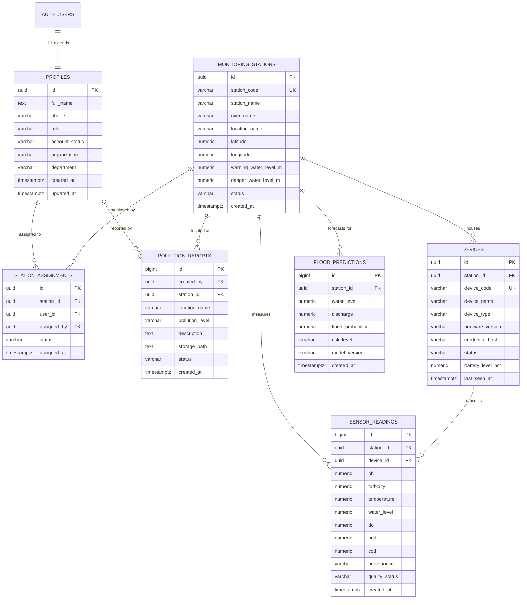

# River Sentinel 2.0 — Phase 2 Relational Database Schema Specification

## 1. Overview & Architectural Purpose

Phase 2 establishes the relational backbone of River Sentinel 2.0 on Supabase PostgreSQL (Project ID: `xqzobddgkawysprpmkpk`, Region: `ap-southeast-1`). This schema transitions the application from disconnected flat tables into an integrated relational system supporting:

1. **Multi-Station River Telemetry:** Physical and simulated stations along the Ganga River in Varanasi, India.
2. **Hardware-Ready IoT Device Management:** Pre-shared key cryptographic hashes (SHA-256) and hardware fleet tracking for ESP32 nodes.
3. **Role-Based Access Control (RBAC):** Profiles mapped directly to `auth.users`, strictly separating Citizens, Field Officers, and Authority Administrators.
4. **Sanitized Public Consumption:** Separation of raw device telemetry from sanitized public environmental metrics via `public_sensor_telemetry`.
5. **Private Chain-of-Custody Evidence:** Storage bucket pointers for pollution incident photographs with fine-grained access policies.

---

## 2. Entity-Relationship Diagram

---

## 3. Table Definitions & Constraints

### 3.1 `public.profiles`
Links directly to Supabase Auth `auth.users(id)`:
- `id`: `UUID PRIMARY KEY REFERENCES auth.users(id) ON DELETE CASCADE`
- `full_name`: `TEXT NOT NULL DEFAULT ''`
- `phone`: `VARCHAR(20)`
- `role`: `VARCHAR(30) NOT NULL DEFAULT 'citizen' CHECK (role IN ('citizen', 'field_officer', 'authority_admin'))`
- `account_status`: `VARCHAR(20) NOT NULL DEFAULT 'active' CHECK (account_status IN ('active', 'suspended', 'pending'))`
- `organization`: `VARCHAR(100)` (e.g., 'UP Pollution Control Board')
- `department`: `VARCHAR(100)`
- `created_at`: `TIMESTAMPTZ NOT NULL DEFAULT now()`
- `updated_at`: `TIMESTAMPTZ NOT NULL DEFAULT now()`

### 3.2 `public.monitoring_stations`
Tracks monitoring locations along the Ganga River in Varanasi:
- `id`: `UUID PRIMARY KEY DEFAULT gen_random_uuid()`
- `station_code`: `VARCHAR(50) UNIQUE NOT NULL` (e.g. `STN-VAR-ASSI-01`)
- `station_name`: `VARCHAR(100) NOT NULL`
- `river_name`: `VARCHAR(50) NOT NULL DEFAULT 'Ganga'`
- `description`: `TEXT`
- `location_name`: `VARCHAR(100) NOT NULL`
- `latitude`: `NUMERIC(9,6) NOT NULL`
- `longitude`: `NUMERIC(9,6) NOT NULL`
- `warning_water_level_m`: `NUMERIC(6,2) DEFAULT 71.26` (Varanasi Warning Flood Level)
- `danger_water_level_m`: `NUMERIC(6,2) DEFAULT 73.23` (Varanasi Danger Flood Level)
- `installation_date`: `DATE DEFAULT CURRENT_DATE`
- `status`: `VARCHAR(20) NOT NULL DEFAULT 'active' CHECK (status IN ('active', 'maintenance', 'decommissioned'))`

### 3.3 `public.devices`
Tracks physical ESP32-WROOM-32 microcontrollers and simulated nodes:
- `id`: `UUID PRIMARY KEY DEFAULT gen_random_uuid()`
- `station_id`: `UUID REFERENCES public.monitoring_stations(id) ON DELETE SET NULL`
- `device_code`: `VARCHAR(50) UNIQUE NOT NULL` (e.g. `DEV-ESP32-ASSI-01`)
- `device_name`: `VARCHAR(100) NOT NULL`
- `device_type`: `VARCHAR(50) NOT NULL DEFAULT 'ESP32-WROOM-32'`
- `firmware_version`: `VARCHAR(20) DEFAULT 'v1.0.0'`
- `credential_hash`: `VARCHAR(128) NOT NULL` (SHA-256 pre-shared key digest)
- `status`: `VARCHAR(20) NOT NULL DEFAULT 'provisioned' CHECK (status IN ('provisioned', 'active', 'inactive', 'revoked'))`
- `last_seen_at`: `TIMESTAMPTZ`
- `battery_level_pct`: `NUMERIC(5,2)`

### 3.4 `public.station_assignments`
Manages field officer geographic responsibilities:
- `id`: `UUID PRIMARY KEY DEFAULT gen_random_uuid()`
- `station_id`: `UUID NOT NULL REFERENCES public.monitoring_stations(id) ON DELETE CASCADE`
- `user_id`: `UUID NOT NULL REFERENCES public.profiles(id) ON DELETE CASCADE`
- `assigned_by`: `UUID REFERENCES public.profiles(id) ON DELETE SET NULL`
- `assigned_at`: `TIMESTAMPTZ NOT NULL DEFAULT now()`
- `status`: `VARCHAR(20) NOT NULL DEFAULT 'active' CHECK (status IN ('active', 'revoked'))`
- `UNIQUE (station_id, user_id)`

---

## 4. Sanitized Public View

### `public.public_sensor_telemetry`
`WITH (security_invoker = true)`:
Exposes only non-sensitive river quality and physical measurement fields (`id`, `created_at`, `station_id`, `ph`, `turbidity`, `temperature`, `humidity`, `ec`, `water_level`, `bod`, `cod`, `do`, `provenance`, `status`). Internal hardware identifiers, battery levels, and telemetry tokens are entirely omitted.
