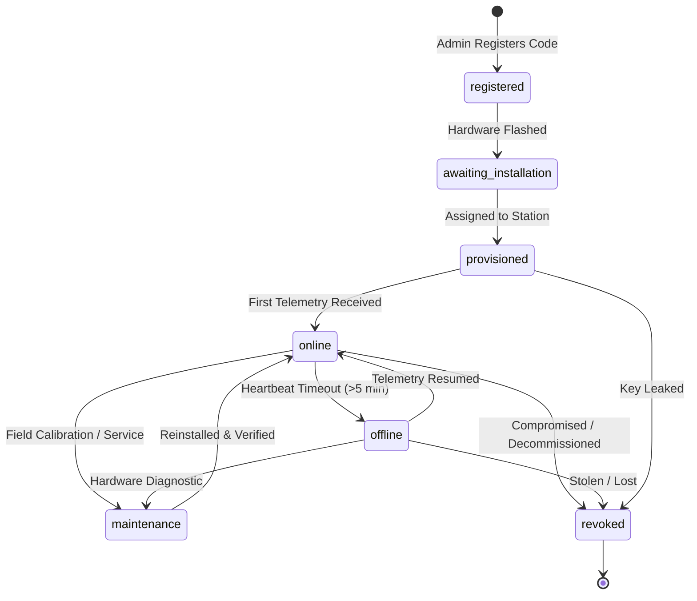

# River Sentinel 2.0 — Phase 3A Device Provisioning & Lifecycle Guide

## 1. Overview & Security Principles

Physical microcontrollers operating in outdoor river environments must never hold human credentials, broad database keys, or shared development secrets.

River Sentinel 2.0 enforces a strict one-time device provisioning workflow:
1. **Isolated Credentials:** Each ESP32 node is provisioned with an independent, randomly generated 192-bit token (`rs_dev_<48-hex>`).
2. **Zero Plaintext Storage:** The server and database only retain the SHA-256 digest (`credential_hash`). The token is visible to the administrator strictly once at issuance time.
3. **No Direct Database Writes:** Nodes never hold Supabase service or anon keys. All communication transits through the Flask `/api/v1/telemetry/ingest` proxy.
4. **Lifecycle Enforcement:** Uninstalled devices remain in `provisioned` state and transition automatically to `online` upon the first authenticated telemetry receipt. Compromised or removed hardware can be instantly marked `revoked`.

---

## 2. Device Lifecycle State Machine



---

## 3. Administrator CLI Workflow (`backend/scripts/provision_device.py`)

### 3.1 Provisioning a New Device
```powershell
backend\venv\Scripts\python backend/scripts/provision_device.py --provision DEV-ESP32-ASSI-01 "ESP32 Sensor Unit Assi-01" STN-VAR-ASSI-01
```

**Output:**
```
=================================================================
DEVICE PROVISIONED SUCCESSFULLY
=================================================================
Device Code:     DEV-ESP32-ASSI-01
Device Name:     ESP32 Sensor Unit Assi-01
Station Code:    STN-VAR-ASSI-01 (Assi Ghat Monitoring Station)
Lifecycle State: provisioned
Credential Hash: a9f1ec52c7b5f928e815...
-----------------------------------------------------------------
⚠️  ONE-TIME PRE-SHARED KEY (STORE IN ESP32 config.h NOW):
   DEVICE_TOKEN = rs_dev_9f8e7d6c5b4a3120ef890123456789abcdef0123456789ab
-----------------------------------------------------------------
This secret will NEVER be displayed again or stored in plaintext.
=================================================================
```

### 3.2 Rotating an Existing Device Credential
If a physical board is serviced or its configuration compromised:
```powershell
backend\venv\Scripts\python backend/scripts/provision_device.py --rotate DEV-ESP32-ASSI-01
```

### 3.3 Revoking a Device Immediately
```powershell
backend\venv\Scripts\python backend/scripts/provision_device.py --revoke DEV-ESP32-ASSI-01
```
Any subsequent request carrying the revoked token or device code is rejected with **HTTP 401 Unauthorized (`Device credentials have been revoked by authority`)**.

### 3.4 Listing All Registered Hardware
```powershell
backend\venv\Scripts\python backend/scripts/provision_device.py --list
```
