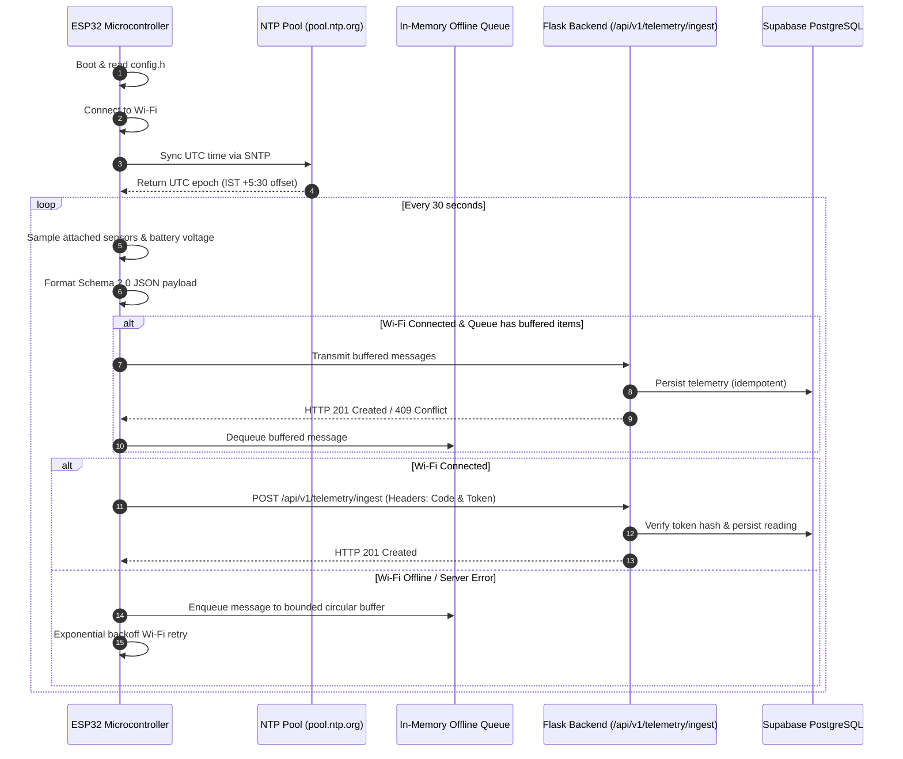

# River Sentinel 2.0 — Phase 3A ESP32 Firmware Architecture Guide

## 1. Architectural Principles

The ESP32 firmware in `arduino/river_sentinel_esp32/` implements an edge monitoring framework for the Ganga River:

1. **Zero Secret Exposure:** Credentials (`DEVICE_TOKEN`, Wi-Fi passwords) are isolated in `config.h` (ignored by Git). Serial logging truncates and redacts tokens (`rs_dev_...[REDACTED]...`).
2. **Deterministic State Machine:** Non-blocking sampling intervals, automated Wi-Fi reconnect with exponential backoff (up to 60s), and bounded queue flushing.
3. **Synchronized UTC Sampling:** Uses SNTP to acquire UTC timestamps. If unsynchronized, timestamps flag `unsynchronized_local` without fabricating UTC time.
4. **Abstract Sensor Drivers:** All probes inherit from `ISensor`. Unconfigured probes report `not_configured` without fabricating false zero or safe values.

---

## 2. Firmware File Structure

```
arduino/river_sentinel_esp32/
├── river_sentinel_esp32.ino    # Firmware entrypoint, setup() & loop() state machine
├── config.example.h            # Configuration template (Git-tracked)
├── config.h                    # Local device credentials (Ignored by Git)
├── wifi_manager.h              # Wi-Fi STA connection, RSSI & exponential backoff
├── time_sync.h                 # SNTP UTC synchronization & ISO 8601 formatting
├── device_auth.h               # Token encapsulation & redacted serial logging
├── device_status.h             # Heap, uptime, Wi-Fi RSSI, & battery ADC monitoring
├── offline_queue.h             # Bounded circular buffer (bounded RAM)
├── sensor_manager.h            # Abstract sensor orchestrator
├── telemetry_client.h          # HTTPS client for Schema 2.0 payload transmission
├── sensor_interfaces/
│   └── ISensor.h               # Base class & SensorQuality enums
└── README.md                   # Flashing instructions & pinout guidelines
```

---

## 3. Communication Lifecycle & Offline Queue Flow



---

## 4. Compilation & Deployment Settings

- **Board:** ESP32 Dev Module (or NodeMCU-32S / ESP32-WROOM-32D)
- **CPU Frequency:** 240 MHz (WiFi/BT)
- **Flash Frequency:** 80 MHz
- **Flash Mode:** QIO
- **Flash Size:** 4MB (32Mb)
- **Partition Scheme:** Default 4MB with spiffs (1.2MB APP / 1.5MB SPIFFS)
- **Core Debug Level:** None (Production) / Info (Lab Verification)
