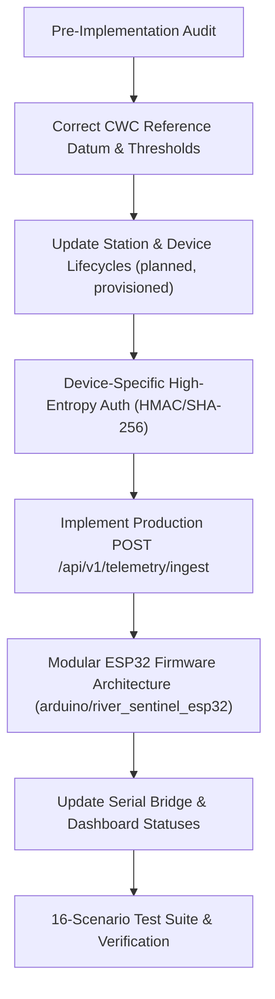

# River Sentinel 2.0 — Phase 3A Pre-Implementation Audit

**Date:** November 19, 2026  
**Auditor:** Full-Stack & IoT Systems Architect  
**Branch:** `river-sentinel/phase-1-stabilization`  
**Checkpoint Commit:** `ca7094b`  
**Target Environment:** Development Project `river-sentinel-dev` (`xqzobddgkawysprpmkpk`, `ap-southeast-1`)

---

## 1. Executive Summary & Audit Purpose

This pre-implementation audit rigorously examines the baseline established at commit `ca7094b` prior to beginning Phase 3A (IoT Communication Architecture and Hardware-Ready Implementation). It verifies live database state, device models, telemetry contracts, existing serial/firmware scripts, and highlights critical discrepancies that must be rectified before connecting physical ESP32 microcontrollers.

---

## 2. Detailed Audit Findings across 10 Verification Areas

### 2.1 Git Branch & Working Tree
- **Status:** Verified.
- **Current Branch:** `river-sentinel/phase-1-stabilization`.
- **Working Tree:** Clean (0 uncommitted changes, 0 untracked files).
- **History Alignment:** Previous commits `011875d` (Supabase base), `2ae924b` (Phase 1A), and `ca7094b` (Phase 2) are intact.

### 2.2 Supabase PostgreSQL Schema
- **Status:** Operational.
- **Public Tables:** `profiles`, `monitoring_stations`, `devices`, `station_assignments`, `sensor_readings`, `pollution_reports`, `flood_predictions`.
- **Public Views:** `public_sensor_telemetry` (`security_invoker = true`).
- **Storage:** Private bucket `pollution-evidence` configured.
- **RLS:** Enabled across all 7 base tables.

### 2.3 Monitoring Stations & CWC Flood Levels Discrepancy
- **Current State:** 4 ghat stations (`STN-VAR-ASSI-01`, `STN-VAR-DASH-02`, `STN-VAR-MANI-03`, `STN-VAR-RAJG-04`) were seeded with status `'active'` and thresholds `warning_water_level_m = 71.26`, `danger_water_level_m = 73.23`.
- **Critical Deficiency Identified:**
  1. **Incorrect Values:** The official CWC Varanasi Reference Gauge thresholds (Source: *CWC Flood Forecasting and Warning Network Performance Appraisal Report 2024, Annex II*) are:
     - Warning Level: **70.26 m**
     - Danger Level: **71.26 m**
     - Highest Flood Level (HFL): **73.90 m** (Lat: ~25.33°N, Lon: ~83.04°E).
  2. **Indiscriminate Gauge Application:** The CWC reference gauge was incorrectly applied as local thresholds across all 4 ghats without distinction. Local sensor mountings require a documented datum conversion before equating sensor readings with the CWC GTS Mean Sea Level gauge.
  3. **Premature 'Active' Status:** Ghat stations lack physical hardware deployments and must reflect explicit lifecycle states (`planned` or `installation_pending`).

### 2.4 Device Registry & Credential Storage
- **Current State:** 4 devices (`DEV-ESP32-*-01..04`) exist in `public.devices`.
- **Critical Deficiency Identified:**
  1. **Fabricated Status & Telemetry:** Devices were seeded with `status: 'active'` and fabricated `battery_level_pct: 98.50, 95.00, etc.`, with `last_seen_at: NULL`. In accordance with system safety, battery and last seen must be `NULL` until physically reported by live hardware.
  2. **Predictable Pre-Shared Keys:** Seed hashes used predictable seed strings (`'river-sentinel-assi-secret-token-2026'`). All seed credentials must be revoked and replaced by a cryptographically secure one-time provisioning mechanism generating high-entropy tokens (`rs_dev_...`).

### 2.5 `sensor_readings` Provenance & Foreign Keys
- **Current State:** Total 8 records exist in `sensor_readings`, all having `provenance = 'simulated'`.
- **Discrepancy:** Rows 1–6 were retroactively stamped with `station_id` and `device_id` pointing to Assi Ghat and `DEV-ESP32-ASSI-01`. Because these records were generated by the software simulator, attributing them to an uninstalled physical device is invalid. `device_id` must be `NULL` for simulated telemetry.

### 2.6 Simulator Ingestion Endpoint (`/api/telemetry/simulate`)
- **Current State:** Operational, authenticated via `X-Simulator-Token`.
- **Finding:** Correctly requires shared simulator secret, but currently shares backend database persistence logic without a strict boundary between simulator payloads and production hardware telemetry schemas.

### 2.7 Serial Bridge (`backend/serial_bridge.py`)
- **Current State:** Functional USB serial reader using PySerial.
- **Deficiency Identified:**
  1. Forwards serial data to `/api/telemetry/simulate` with `X-Simulator-Token` and hardcodes `provenance: 'real_sensor'`, conflating simulation auth with physical hardware ingestion.
  2. Lacks device-specific token authorization and hardware message integrity validation.

### 2.8 Existing Arduino Firmware (`arduino/firebase_sensor_upload.ino`)
- **Current State:** Obsolete legacy sketch created prior to Phase 1.
- **Critical Incompatibilities:**
  1. Targets deactivated Firebase Realtime Database with hardcoded secrets.
  2. Uses `millis() / 1000` as a fake Unix timestamp.
  3. Fabricates `readBOD()` and `readCOD()` functions (parameters that cannot be directly measured by basic field microcontrollers).
  4. Lacks TLS certificate validation, offline message queueing, retry backoff, and device authentication headers.
  5. Must be replaced by a modular C++/Arduino framework in `arduino/river_sentinel_esp32/`.

### 2.9 Authentication Middleware (`backend/services/auth_service.py`)
- **Current State:** Verifies Supabase user JWTs and enforces RBAC (`@require_auth`, `@require_role`).
- **Requirement for Phase 3A:** Needs a dedicated device authentication service (`backend/services/device_auth_service.py`) that performs constant-time SHA-256 verification against `public.devices.credential_hash`, verifies device lifecycle state, and derives station bindings on the server.

### 2.10 Storage & Row-Level Security
- **Current State:** Strict RLS protects `pollution_reports`, `profiles`, `devices`, and `storage.objects`.
- **Requirement for Phase 3A:** Ensure physical telemetry ingestion through the Flask backend (`service_role`) respects device status while preventing direct public writes to `sensor_readings`.

---

## 3. Phase 3A Remediation Roadmap

1. **Step 1:** Author database migration `20261119000002_phase3a_cwc_and_device_lifecycle.sql` to correct CWC levels, add explicit lifecycle enum constraints, purge fabricated battery/status values, and reset device credentials.
2. **Step 2:** Build `backend/services/device_auth_service.py` with constant-time token verification and device lifecycle checks.
3. **Step 3:** Implement dedicated `POST /api/v1/telemetry/ingest` with full validation of sequence numbers, message uniqueness, unit verification, and quality statuses (`valid`, `out_of_range`, `disconnected`, etc.).
4. **Step 4:** Separate simulator authentication and payload schemas completely.
5. **Step 5:** Create modular Arduino/C++ ESP32 firmware in `arduino/river_sentinel_esp32/`.
6. **Step 6:** Refactor `backend/serial_bridge.py` to route to `/api/v1/telemetry/ingest` using device-specific credentials.
7. **Step 7:** Update dashboard UI to distinguish planned vs installed stations and provisioned vs online vs offline devices.
8. **Step 8:** Execute 16-scenario integration test suite and document Phase 3A deliverables.
