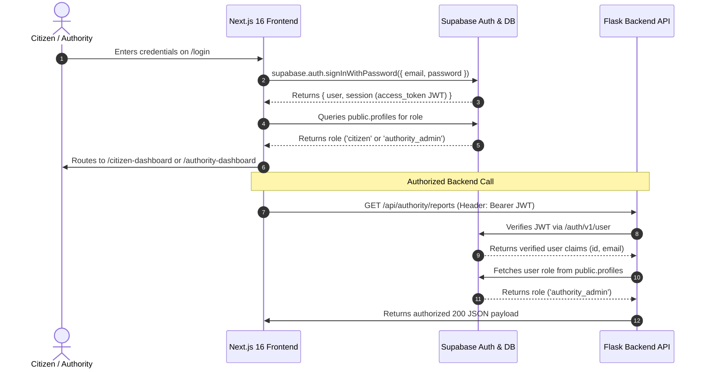

# River Sentinel 2.0 — Phase 2 Authentication Architecture

## 1. Authentication Architecture Overview

River Sentinel 2.0 uses Supabase Authentication as the single source of identity truth across both the Next.js frontend and Flask backend:



---

## 2. Frontend Implementation

### 2.1 Supabase Client (`frontend/src/lib/supabaseClient.ts`)
```typescript
import { createClient } from '@supabase/supabase-js';

const supabaseUrl = process.env.NEXT_PUBLIC_SUPABASE_URL || 'https://xqzobddgkawysprpmkpk.supabase.co';
const supabaseAnonKey = process.env.NEXT_PUBLIC_SUPABASE_ANON_KEY || '';

export const supabase = createClient(supabaseUrl, supabaseAnonKey, {
  auth: {
    persistSession: true,
    autoRefreshToken: true,
    detectSessionInUrl: true,
  },
});
```

### 2.2 Role-Based Routing (`frontend/src/app/login/page.tsx`)
1. User logs in with email & password.
2. The user profile is retrieved from `public.profiles`.
3. If `role` is `authority_admin` or `field_officer`, user is routed to `/authority-dashboard`.
4. If `role` is `citizen`, user is routed to `/citizen-dashboard`.
5. Clear error banners are rendered if authentication fails.

---

## 3. Backend Verification & Decorators (`backend/services/auth_service.py`)

The backend validates tokens via Supabase Auth API endpoint `/auth/v1/user`. This avoids JWT secret configuration errors and ensures immediate session revocation support.

### Available Decorators:
- `@require_auth`: Enforces that a valid `Authorization: Bearer <token>` is present. Attaches `request.user`, `request.user_profile`, and `request.user_role`.
- `@require_role('authority_admin', 'field_officer')`: Verifies that the authenticated user possesses an authorized role in `public.profiles`. Returns 403 Forbidden if not.
- `@optional_auth`: Extracts identity if present, otherwise defaults `request.user = None` and `request.user_role = 'anonymous'`.

### Caching Optimization:
Tokens and user profiles are cached in-memory with a 60-second TTL to eliminate redundant verification network calls during rapid dashboard polling cycles.

---

## 4. Initial Administrator Bootstrap Procedure

To promote an initial user to `authority_admin`:
```powershell
backend\venv\Scripts\python backend/scripts/bootstrap_admin.py <user_email_or_uuid>
```
The script calls `public.bootstrap_initial_admin(admin_user_id)` via direct database connection with service role authority.
